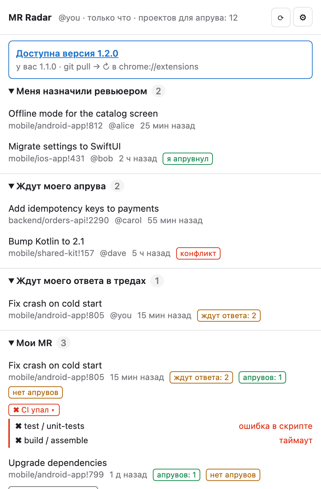
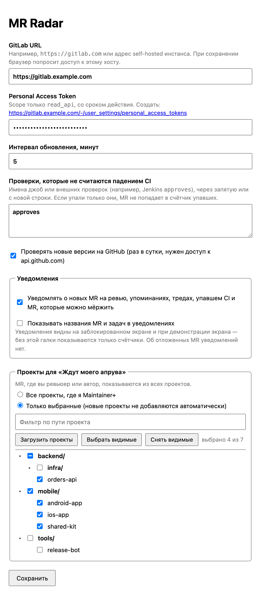

# GitLab MR Radar

Chrome-расширение (Manifest V3) для любого GitLab-инстанса (gitlab.com или self-hosted). Показывает в popup открытые MR, которых не хватает в дашборде GitLab Free, и выводит счётчик на иконке.

<p>
  <picture>
    <source media="(prefers-color-scheme: dark)" srcset="docs/popup-dark.png">
    
  </picture>
  <picture>
    <source media="(prefers-color-scheme: dark)" srcset="docs/options-dark.png">
    
  </picture>
</p>

## Секции

| Секция | Что попадает |
|---|---|
| Меня назначили ревьюером | Открытые MR, где я в reviewers (кроме своих). Если уже апрувнул — помечается тегом |
| Назначены на меня | Открытые MR, где я assignee (кроме своих и тех, где я ревьюер). В GitLab Free assignee часто означает «кто мёржит». Если уже апрувнул — помечается тегом; показывается причина, по которой MR нельзя смёржить |
| Меня упомянули | Открытые MR и задачи (issues, с тегом «задача»), где меня упомянули (`@me`) и я ещё не отреагировал — по pending Todos. Ссылка ведёт прямо к комментарию с упоминанием. MR, где я уже ревьюер или assignee, сюда не попадают |
| Ждут моего апрува | Открытые не-draft MR в проектах, где у меня Maintainer+, не мои, без моего апрува, и где я не ревьюер и не assignee |
| Ждут моего ответа в тредах | Мои MR, MR на ревью и назначенные на меня, где есть нерешённый тред, в котором я участвую (или MR мой), а последний комментарий не мой |
| Мои MR | Мои открытые MR: число апрувов, причина, по которой MR нельзя смёржить (нет апрувов, треды, нужен rebase, конфликт, внешние проверки, заблокирован другим MR и т. д.), треды, статус CI. По клику на «CI упал» раскрывается список упавших джоб с причиной и ссылками |
| Сломан default branch | Проекты для «Ждут моего апрува», где последний пайплайн default-ветки с результатом (успех или падение; отменённые и пропущенные не учитываются) упал. В счётчик на иконке не входит |

Счётчик на иконке — два числа `ждут·упал CI`:
- **ждут действия** — уникальные MR и задачи: ревью и назначенные на меня без моего апрува (не draft) + упоминания + ждут моего апрува + ждут ответа в тредах;
- **упал CI** — мои MR с упавшим пайплайном. Если упавших нет, показывается одно число на синем фоне, если есть — бейдж красный. Подробности — в подсказке при наведении.

Время последней активности окрашивается: больше 3 дней — жёлтым, больше недели — красным.

Если токен истекает в ближайшие 7 дней, бессрочный или у него есть права сверх `read_api`, в popup появляется предупреждение со ссылкой на создание нового токена (`GET /personal_access_tokens/self`; на старых GitLab без этого эндпоинта проверка молча пропускается).

Проверки из списка «не считаются падением CI» (например, Jenkins-проверка апрувов `approves`) не увеличивают счётчик упавших: если упали только они, MR помечается серым «CI ждёт: …».

### Отложить MR

Кнопка ⏰ в строке MR (появляется при наведении) откладывает его: на 1 час, до 9:00 следующего дня или до изменений в MR (новый коммит, комментарий, апрув — всё, что меняет `updated_at`). Отложенный MR пропадает из всех секций и из счётчика и показывается в свёрнутой секции «Отложено», откуда его можно вернуть кнопкой ↩. Когда срок истекает, MR возвращается в секции и счётчик сам, без ожидания следующего обновления. Состояние хранится локально в браузере и сбрасывается при смене GitLab URL.

### Уведомления

Включаются в настройках (браузер попросит разрешение). После каждого обновления приходит одно сгруппированное уведомление о том, что появилось с прошлого раза: новые MR на ревью и назначенные на меня (в том числе если мой апрув сбросился), упоминания, MR, ждущие апрува, новые ответы в тредах, упавший CI моих MR, мои MR, которые стали можно мёржить, и проекты, где упала default-ветка. Уведомлений нет: о первом обновлении после установки, о смене GitLab, пользователя (другой токен), выбранных проектов или списка игнорируемых проверок, об отложенных MR. Если в прошлый раз часть данных не загрузилась (упоминания, статусы CI, назначенные на меня MR, статусы default branch, отдельные проекты или MR), уведомление придёт только об изменениях уже известных MR, а не обо всех «вернувшихся». По умолчанию в уведомлении только счётчики — названия MR, задач и проектов видны на заблокированном экране, поэтому показываются только с отдельной галкой. Клик открывает MR, если он один, иначе popup (или главную GitLab, если браузер не дал открыть popup).

### Несколько ревьюеров в GitLab Free

В GitLab Free/CE у MR может быть только один ревьюер — ограничение проверяется на сервере, обойти его через API или quick actions нельзя. Рабочая замена: одного человека назначить ревьюером, остальных упомянуть в описании или комментарии (`/cc @bob @carol`, удобно положить в шаблон `.gitlab/merge_request_templates/Default.md`). У упомянутых MR появится в секции «Меня упомянули» и в счётчике — до тех пор, пока они не отреагируют (комментарий, апрув или «Mark as done» в GitLab).

## Установка

1. Скачать `gitlab-mr-radar-<версия>.zip` со страницы [Releases](../../releases) и распаковать (или склонировать репозиторий).
2. `chrome://extensions` → включить **Developer mode** → **Load unpacked** → выбрать распакованную папку.
3. Открыть настройки расширения (⚙ в popup):
   - **GitLab URL** — `https://gitlab.com` или адрес своего инстанса (только https), в точности как в адресной строке GitLab — иначе ссылки в popup будут вести на главную. При сохранении Chrome попросит доступ к этому хосту — без него расширение не работает;
   - **Personal Access Token** — scope **только `read_api`**, обязательно со сроком действия (ссылка на создание токена появится под полем);
   - интервал обновления.
4. Опционально — уведомления, список проверок, которые не считаются падением CI, и галка «Проверять новые версии» (раз в сутки запрос к `api.github.com`, доступ запрашивается при включении; в popup появится баннер со ссылкой на релиз).
5. Опционально — ограничить проекты для секции «Ждут моего апрува»: режим «Только выбранные» → «Загрузить проекты». Проекты показываются деревом по группам; чекбокс группы (включая корневую) выбирает или снимает все проекты внутри. Есть фильтр по пути. MR, где я ревьюер или автор, показываются из всех проектов независимо от фильтра. Новые проекты в режиме «выбранные» не подхватываются автоматически.

Если GitLab недоступен (нет сети/VPN), на иконке `!`, в popup — причина.

## Как устроено

- `src/gitlab.js` — клиент GitLab (REST API v4 и GraphQL, ретраи на 429) и запросы к отдельным эндпоинтам. Используются только эндпоинты Free-тира.
- `src/dashboard.js` — сбор дашборда конвейером: `fetchRaw` (пользователь, списки MR — мои, на ревью, назначенные на меня, проекты с `min_access_level=40`, todos, пайплайны моих MR и default-веток, срок и права токена) → `enrich` (апрувы и счётчики тредов, `/discussions`, упавшие джобы) → `classify` (раскладка по секциям). Обязательные источники — пользователь и мои списки MR; если недоступны проекты, упоминания или статусы CI, дашборд собирается без них с пометкой в popup. То же для списка назначенных на меня MR. Проект или MR, по которым GitLab вернул 403/404/5xx, пропускаются; если не ответил ни один и среди ошибок есть 5xx — обновление считается ошибкой, и popup остаётся с прошлыми данными. 401 и 429 всегда прерывают обновление.
- `src/view.js` — `deriveView`: секции и счётчики бейджа из дашборда; одна функция для popup и бейджа.
- `src/links.js` — проверка ссылок: GitLab-ссылки только внутри указанного инстанса, ссылки внешних CI — только https.
- Апрувы и счётчики тредов (`approvedBy`, `userNotesCount`, `resolvableDiscussionsCount`, `resolvedDiscussionsCount`) — одним GraphQL-запросом на проект (до 100 MR в запросе) вместо `/approvals` по каждому MR. `/discussions` загружаются только для моих MR, MR на ревью и назначенных на меня, где есть нерешённые треды, и только если с прошлого обновления изменились `updated_at` MR, число заметок или решённых/нерешённых тредов — иначе число тредов, ждущих ответа, берётся из кеша (`threadCache` в `chrome.storage.local`, привязан к GitLab URL и пользователю). Если GraphQL недоступен (старый GitLab, ошибка), по таким MR используется прежний путь через REST `/approvals` и `/discussions` без кеша.
- Упоминания — pending Todos (`GET /todos?state=pending&type=MergeRequest` и `type=Issue`, действия `mentioned` и `directly_addressed`), два запроса на обновление.
- Default-ветки — GraphQL-запрос с последним завершённым пайплайном (`project.pipelines(ref:, scope: FINISHED, first: 5)`, берётся первый успешный или упавший) на 20 проектов; пути проектов и имена веток передаются только переменными. Если запрос не прошёл, в popup пометка «статусы default branch недоступны».
- Статусы пайплайнов моих MR — одним GraphQL-запросом (`currentUser.authoredMergeRequests.headPipeline`). Для моих MR с упавшим пайплайном при обновлении загружаются упавшие джобы (`/pipelines/:id/jobs?scope[]=failed`, `/bridges`) и упавшие статусы внешних CI, например Jenkins (`/repository/commits/:sha/statuses?pipeline_id=`): это нужно для списка исключений и раскрывающегося блока в popup.
- `src/snooze.js` — отложенные MR; `src/notifications.js` — текст и цель уведомления. События считает `collectNotificationEvents` (`src/view.js`) сравнением прошлого и нового дашборда через тот же `deriveView`, поэтому отложенные MR не попадают ни в счётчик, ни в уведомления.
- `src/background.js` — service worker: обновление по `chrome.alarms`, результат в `chrome.storage.local`, бейдж, уведомления. Отложенные MR — отдельный ключ `userState`; его пишет только popup, а background по изменению пересчитывает бейдж.
- `src/popup.*` — рендер из storage, кнопка ручного обновления, откладывание MR.
- `src/options.*` — URL, токен, интервал, уведомления, выбор проектов.

## Безопасность

- Доступ к хостам запрашивается в рантайме (`optional_host_permissions`) только для указанного GitLab; при смене URL доступ к старому хосту отзывается.
- Токен хранится в `chrome.storage.local` (не синхронизируется между устройствами) и отправляется только в заголовках запросов на указанный хост (`PRIVATE-TOKEN`, для GraphQL также `Authorization: Bearer`).
- Разрешение на уведомления — опциональное (`optional_permissions`), запрашивается при включении и отзывается при выключении. Названия MR, задач и проектов в уведомлениях только по явной галке.
- Popup строит DOM только через `textContent`, ссылки открываются только внутри указанного GitLab; ссылки внешних CI-проверок (их может задать любой разработчик проекта) — только https.

## Разработка

Тесты — встроенный раннер Node.js 20+, без зависимостей:

```sh
node --test
```

CI (`.github/workflows/ci.yml`) прогоняет тесты, проверяет `manifest.json` и собирает архив через `scripts/build.sh`.

## Обновление

Скачать новый релиз и заменить папку, затем кнопка ↻ у расширения на `chrome://extensions`.

## Лицензия

MIT
